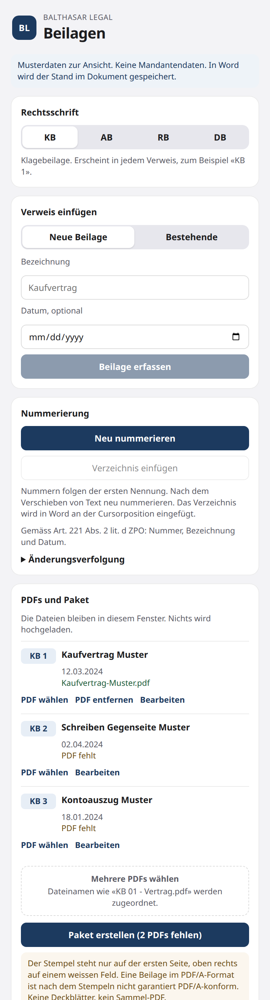
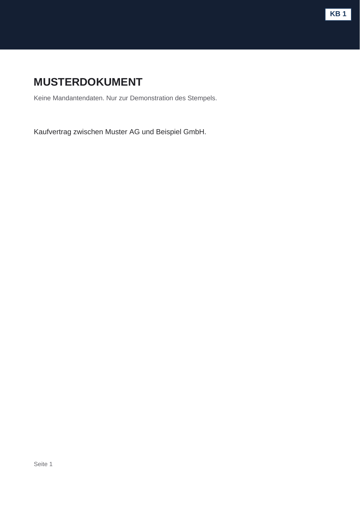

# Beilagen bedienen

Der Aufgabenbereich in der Abbildung läuft ausserhalb von Word, mit Musterdaten. Deshalb ist «Verzeichnis einfügen» gesperrt und der Knopf heisst «Beilage erfassen». In Word heisst er «Am Cursor einfügen», und das Verzeichnis wird ins Dokument geschrieben.

Aufgabenbereich über Start, Gruppe Beilagen öffnen. Die Sprache ist Deutsch in Schweizer Schreibweise.

## Kürzel

Für das offene Dokument eines wählen:

| Kürzel | Bedeutung |
| --- | --- |
| KB | Klagebeilage |
| AB | Antwortbeilage |
| RB | Replikbeilage |
| DB | Duplikbeilage |

Die Wahl wird im Dokument gespeichert. Darunter steht ein Feld für ein eigenes Kürzel, zum Beispiel «BV». Es gelten Buchstaben, Ziffern, Punkt und Bindestrich, höchstens 12 Zeichen. Ein späterer Wechsel schreibt alle sichtbaren Verweise um, zum Beispiel von «KB 1» auf «AB 1». Gibt es schon Beilagen, fragt der Aufgabenbereich nach.

Neben dem Kürzel liegt die Bezeichnung der einzelnen Beilage, zum Beispiel «Kaufvertrag vom 3. März 2025». Die Reihenfolge wird ebenfalls im Dokument gespeichert. Voreingestellt ist die Nummer links, getrennt durch ein Leerzeichen: «KB 1 Kaufvertrag vom 3. März 2025». «Bezeichnung zuerst» setzt die Nummer in Klammern: «Kaufvertrag vom 3. März 2025 (KB 1)».

## Verweis einfügen

Cursor an die Stelle setzen, an der der Verweis stehen soll. «Am Cursor einfügen» setzt ein Inhaltssteuerelement mit Nummer und Bezeichnung. Bestehende Beilagen lassen sich erneut einfügen; sie behalten ihre Nummer.

Die Nummer «KB 1» enthält ein geschütztes Leerzeichen, damit sie nicht umbricht. Dieselbe Beilage trägt überall dieselbe Nummer. Die stabile Beilagen-ID steckt im Tag des äusseren Inhaltssteuerelements, nicht im sichtbaren Text. Kopieren übernimmt den Verweis auf dieselbe Beilage. Ausschneiden und Einfügen verschiebt ihn.

Fett, kursiv, Schrift, Grösse und Farbe lassen sich in Word auf den Verweis anwenden. «Neu nummerieren» und eine geänderte Bezeichnung ersetzen nur das betreffende Stück und setzen die bisherige einheitliche Zeichenformatierung wieder. Das äussere Inhaltssteuerelement bleibt bestehen. Eine gemischte Formatierung innerhalb der Nummer oder innerhalb der Bezeichnung bleibt, solange dieser Text selbst nicht geändert wird. Wechselt die Reihenfolge, wird der Verweis neu aufgebaut; die einheitliche Formatierung von Nummer und Bezeichnung wird danach wieder gesetzt.

Eine von Hand geänderte Nummer wird beim nächsten «Neu nummerieren» überschrieben, die Formatierung bleibt.

«Entfernen» in der Beilagenliste fragt kurz nach und löscht dann alle Verweise dieser Beilage im Text, den Eintrag in der Liste und ein zugeordnetes PDF. Die übrigen Beilagen werden sofort neu nummeriert, ohne Lücke. Wird ein Verweis in Word von Hand gelöscht und bleibt keiner übrig, verschwindet die Beilage beim nächsten «Neu nummerieren» und auch beim erneuten Öffnen des Aufgabenbereichs. Das zugeordnete PDF fällt dabei weg.

## Neu nummerieren

Der Knopf vergibt die Nummern nach der ersten Nennung im Dokumentkörper neu, einschliesslich Tabellen. Weitere Nennungen derselben Beilage bleiben bei dieser Nummer. Danach das Beweismittelverzeichnis mitziehen, falls eines im Dokument steht.

Nach dem Umstellen von Absätzen den Knopf erneut drücken. Es gibt keine automatische Aktualisierung beim Tippen; der Knopf ist der verlässliche Weg. Beim Einfügen eines Verweises wird einmal mitnummeriert, damit der neue Verweis nicht mit einer vorläufigen Nummer stehen bleibt.

Nicht einbezogen werden Verweise in Fussnoten, Endnoten, Kopf- und Fusszeilen, Textfeldern und Kommentaren.

Eine Beilage ohne verbleibenden Verweis wird dabei aus der Liste genommen. Die Nummern der übrigen Beilagen bleiben lückenlos.

## Änderungsverfolgung

Ist die Änderungsverfolgung eingeschaltet, protokolliert Word die neue Nummer als Änderung: der alte Verweistext ist gelöscht, der neue eingefügt. Die Beilagen-ID bleibt. Vor dem Versand die Änderung annehmen oder die Nachverfolgung für diesen Augenblick ausschalten. Das Add-in schaltet sie nicht selbst aus.

Ab WordApi 1.4 zählt ein Verweis nicht mehr mit, wenn er in der Änderungsverfolgung als vollständig gelöscht gilt. In älteren Word-Fassungen zählt ein noch nicht angenommener Löschvorschlag weiter, bis er angenommen ist. Der Aufgabenbereich zeigt unten die erkannte WordApi-Fassung.

Schlägt das Schreiben eines Verweises fehl, bleibt die bisherige Nummer stehen und der Aufgabenbereich meldet es. Dann die Änderung annehmen und «Neu nummerieren» wiederholen.

## Beweismittelverzeichnis

«Verzeichnis einfügen» setzt an der Cursorposition eine Tabelle mit Nummer und Bezeichnung. Die Bezeichnung ist dieselbe wie im Verweis. Das entspricht der Bezeichnung der Beweismittel nach Art. 221 Abs. 2 lit. d ZPO. Steht schon ein Verzeichnis im Dokument, wird es an Ort ersetzt. Manuelle Ergänzungen in dieser Tabelle gehen dabei verloren. Verweise gehören in den Text, nicht in die Tabelle. Steht doch einer darin, verweigert die Aktualisierung das Ersetzen, damit der Verweis nicht verloren geht.

## PDFs stempeln und paketieren

Pro nummerierter Beilage eine PDF-Datei wählen. Mehrere Dateien auf einmal werden zugeordnet, wenn der Name mit Kürzel und Nummer beginnt, zum Beispiel `KB 01 - Kaufvertrag.pdf`.

«Paket erstellen» stempelt jedes PDF nur auf der ersten Seite, oben rechts. Der Stempel zeigt Kürzel und Nummer, etwa «KB 1», in Helvetica Fett auf einem weissen Feld mit dunklem Rand, mit Abstand zum Seitenrand. So bleibt er auf hellem und auf dunklem Grund lesbar. Es gibt keine Deckblätter und kein Sammel-PDF.

Das ZIP heisst `Beilagen-KB.zip` und enthält, nach Nummer sortiert:

- `00 Beweismittelverzeichnis.pdf`
- `KB 01 - Kaufvertrag.pdf`
- `KB 02 - Schreiben.pdf`

Startet der Download nicht von selbst, «ZIP speichern» wählen. Die gewählten PDFs bleiben nur im offenen Aufgabenbereich. Nach dem Schliessen müssen sie neu gewählt werden. Verschlüsselte PDFs und Dateien über 80 MB werden abgelehnt.

Eine Beilage im PDF/A-Format ist nach dem Stempeln nicht garantiert PDF/A-konform. pdf-lib schreibt die Datei neu; ein PDF/A-Merkmal bleibt dabei nicht erhalten.

## Bekannte Grenzen

- Ein Kürzel pro Dokument.
- Nummerierung nur im Dokumentkörper, inklusive Tabellen. Mehr als 80 Verweise werden nur dann vollständig nach der Textposition sortiert, wenn Word sie nicht schon in Lesereihenfolge liefert. Eine gewöhnliche Rechtsschrift bleibt darunter.
- PDF-Zuordnung nicht im Dokument gespeichert.
- Stempel nur auf Seite 1, keine inhaltliche Prüfung des PDFs, keine Verschiebung weg von bestehendem Text.
- Seltene Sonderzeichen, die nicht in der Schrift Helvetica (WinAnsi) liegen, werden im Stempel und im Verzeichnis-PDF ersetzt. Umlaute und «» sind enthalten.
- Der Aufgabenbereich braucht die gehostete Adresse aus dem Manifest. Beim lokalen Sideload muss `npm run dev` laufen.
